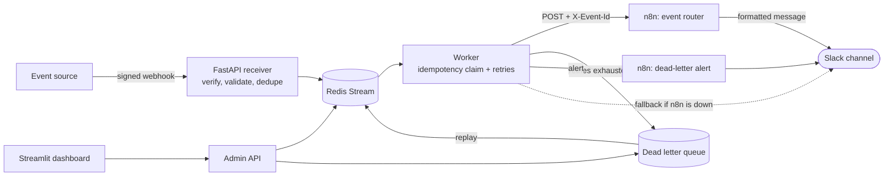

# Event Orchestrator
### Event-Triggered Automation Agent

Event Orchestrator receives signed webhooks, runs matching n8n workflows that post to Slack, and guarantees the delivery: every event is processed idempotently, temporary failures are retried automatically, and events that keep failing are kept in a dead letter queue, announced in Slack, and can be replayed with one click.


## Contents

- [Why this exists](#why-this-exists)
- [Features](#features)
- [Architecture](#architecture)
- [Documentation](#documentation)
- [Tech stack](#tech-stack)
- [Getting started](#getting-started)
- [Try it](#try-it)
- [Project structure](#project-structure)
- [Troubleshooting](#troubleshooting)
- [Future enhancements](#future-enhancements)
- [Author](#author)

## Why this exists

Automation that reacts to events fails in a few predictable ways. This project is built around those failure modes.

| What goes wrong | Without a reliability layer | How Event Orchestrator handles it |
|---|---|---|
| The sender redelivers the same event | The workflow runs twice, so the customer gets two messages or two charges | Duplicates are blocked at the API and again in the worker, using the event ID |
| A downstream service is briefly down | The event is lost, or the sender gives up | The worker retries with exponential backoff and jitter |
| An event can never succeed | It fails silently or retries forever | After the attempts run out it moves to a dead letter queue with the reason, attempt count, last error, and payload |
| Nobody notices a failure | The problem is found days later | A Slack alert is posted the moment an event is dead-lettered |
| The cause is fixed later | Lost events must be re-sent by hand | One click replays the event from the dashboard |
| A forged request arrives | Anyone can trigger your workflows | Every webhook needs a valid HMAC-SHA256 signature |

**Why n8n plus Python?** n8n is the right tool for the business side: routing, formatting messages, and integrating with Slack or other services, all visually and without redeploying code. The reliability logic (idempotency, retries, dead lettering) needs to be explicit, testable, and under version control, so it lives in Python with 42 automated tests. Each does the job it is best at.

## Features

**Reliability**
- **Idempotent processing in two layers.** The API drops repeat deliveries at the door, and the worker atomically claims each event ID before running it. IDs are remembered for 24 hours by default.
- **Retries with exponential backoff and jitter**, capped at 30 seconds between attempts and 5 attempts by default. Timeouts, connection errors, HTTP 5xx, 408, and 429 are retried. Other 4xx responses are treated as permanent and are not retried.
- **Dead letter queue** that stores the failure reason, attempt count, last error, and full payload, with **one-click replay** that safely re-queues the event.
- **Crash recovery.** If a worker dies mid-event, another worker reclaims the unacknowledged message after 60 seconds.

**Integrations**
- **n8n workflow that posts to Slack.** Order and signup events become formatted Slack messages. Everything is built from standard n8n nodes (Webhook, Code, IF, Switch, HTTP Request, Respond to Webhook), and the workflow is importable from this repo.
- **Dead-letter alerts in Slack** from a second lane of the same workflow. If n8n itself is down, the worker posts the alert to Slack directly, so an outage still produces a message.

**Observability**
- **Live dashboard** with counters, n8n health, recent events, and the dead letter queue. It refreshes every 3 seconds.
- **Audit log** in SQLite that records every outcome, since Redis streams get trimmed.

**Security**
- Constant-time HMAC-SHA256 signature verification and strict payload validation.
- The admin API requires a token. The Slack URL lives in `.env` and is never stored in the workflow file or in Git.
- Event fields are escaped before they go into Slack messages, so an event cannot trigger `@channel` notifications.

**Quality and extras**
- **42 automated tests** covering signatures, idempotency, retries, the dead letter queue, alerts, and the executors.
- Optional extras: a queue listener as a second input source, n8n execution history on the dashboard, and an experimental Groq route for `ai.*` events.

## Architecture



### Components

| Component | Role |
|---|---|
| **FastAPI receiver** | Accepts webhooks, verifies the signature, validates the payload, drops duplicates, and queues the event |
| **Redis Stream** | Durable queue with consumer groups, so events survive restarts and crashes |
| **Worker** | Claims each event, calls n8n, retries on transient failures, and routes failures to the dead letter queue |
| **n8n workflow** | Routes by event type, builds the Slack message, posts it, and tells the worker whether it worked |
| **Dead letter queue** | A separate Redis stream holding events that could not be processed, ready for replay |
| **Dashboard and admin API** | Read the queue, counters, audit log, and n8n health, and trigger replays |

### Life of an event

1. The sender POSTs a JSON event with an `X-Signature` header. The API verifies the signature, validates the payload, and drops duplicates.
2. Accepted events are appended to a Redis Stream.
3. A worker atomically claims the event ID, then POSTs the event to the n8n webhook with the ID in an `X-Event-Id` header.
4. n8n routes by event type, builds a Slack message, posts it, and answers 200. If anything fails, n8n answers with an error.
5. On success the ID is marked done. On a transient failure the worker retries with backoff. When attempts run out, the event goes to the dead letter queue, its claim is released so a replay can run again, and a Slack alert is sent.

### Delivery guarantee

Delivery is **at-least-once, not exactly-once**. Retries, redelivery, and crash recovery mean an event is never silently lost, but there is a narrow window (the worker crashes after n8n posted to Slack but before the event is marked done) where an event can run twice. Every Slack message carries the event ID, and the ID is sent to n8n in the `X-Event-Id` header, so duplicates are easy to recognise and downstream workflows can deduplicate.

## Documentation

| Document | What it covers |
|---|---|
| [n8n workflow](docs/n8n-workflow.md) | Both workflow lanes node by node, the Slack messages, how n8n's responses drive retries, setup, and how to add new event types |
| [Dashboard](docs/dashboard.md) | Every counter and table, how replay works, how the dashboard gets its data, and dashboard troubleshooting |

The n8n workflow, as imported from `n8n/workflows/event_router.json`:


## Tech stack

Everything is free and open source.

| Layer | Tool | Why |
|---|---|---|
| Webhook receiver | FastAPI, Uvicorn | Async, with easy access to the raw request body for signature checks |
| Validation and config | Pydantic v2, pydantic-settings | Typed event models and settings loaded from `.env` |
| Signature verification | `hmac`, `hashlib` (standard library) | Constant-time comparison with no extra dependency |
| Event bus | Redis Streams with consumer groups | Built-in acknowledgement, pending tracking, and redelivery |
| Idempotency | Redis `SET NX EX` | Atomic "claim this event ID" with automatic expiry |
| Worker | Python asyncio, `redis-py` | Simple and transparent, so the retry and ack logic is visible |
| Retries | tenacity | Exponential backoff with jitter, and clean separation of transient and permanent errors |
| Workflow engine | n8n (self-hosted Community Edition) | Visual workflows and integrations without writing each connector |
| Notifications | Slack incoming webhooks | Real messages with no OAuth setup |
| HTTP client | httpx | Async calls with timeouts and clear error types |
| Audit log | SQLite | Durable history that survives Redis trimming |
| Dashboard | Streamlit | A live monitoring UI in a few lines of Python |
| Testing | pytest, pytest-asyncio, fakeredis | Duplicate delivery, retry exhaustion, and replay tested without a real Redis |
| Packaging | Docker Compose | One command starts all six services |

## Getting started

### Prerequisites

- **Docker Desktop**
- **A Slack workspace** where you can add an app (a free workspace works)
- **Python 3.11 or newer**, for the test scripts and the tests

### 1. Set up Slack (5 minutes)

1. Go to https://api.slack.com/apps and click **Create New App > From scratch**. Name it and pick your workspace.
2. Open **Incoming Webhooks** and switch **Activate Incoming Webhooks** on.
3. Click **Add New Webhook to Workspace**, choose a channel (a dedicated `#event-alerts` channel is a good idea), and click **Allow**.
4. Copy the webhook URL. It looks like `https://hooks.slack.com/services/T.../B.../...`.

Treat that URL like a password: anyone who has it can post to your channel.

### 2. Clone and configure

```bash
git clone https://github.com/mehak2710/event-orchestrator.git
cd event-orchestrator
```

Create your settings file from the template:

```bash
# Windows
copy .env.example .env

# macOS / Linux
cp .env.example .env
```

Open `.env` and set these three values:

| Variable | What to put |
|---|---|
| `SLACK_WEBHOOK_URL` | The webhook URL you copied from Slack |
| `WEBHOOK_SECRET` | Your own long random value. Senders use it to sign webhooks |
| `ADMIN_TOKEN` | A different long random value. It protects the admin API the dashboard uses |

Generate a random value with:

```bash
python -c "import secrets; print(secrets.token_urlsafe(32))"
```

Leave everything else as it is. These optional settings can stay empty:

| Variable | Default | Purpose |
|---|---|---|
| `GROQ_API_KEY`, `GROQ_MODEL` | empty, `openai/gpt-oss-20b` | Optional `ai.*` route that summarizes events with Groq |
| `N8N_API_KEY` | empty | Optional: shows n8n execution history on the dashboard |
| `MAX_ATTEMPTS` | `5` | Attempts before an event is dead-lettered |

`.env` is gitignored, so your secrets stay out of the repository. After editing it later, run `docker compose up -d` so the containers pick up the change.

### 3. Check Slack works on its own

```bash
python -m venv .venv

# Windows
.venv\Scripts\activate
# macOS / Linux
source .venv/bin/activate

pip install -r requirements-dev.txt
python -m scripts.test_slack
```

A test message should appear in your Slack channel. If it does not, the script prints what Slack answered and what it usually means.

### 4. Start the stack

Make sure Docker Desktop shows "Engine running", then:

```bash
docker compose up -d --build
docker compose ps
```

The first build takes a few minutes. You should see six services running: redis, n8n, api, listener, worker, and dashboard.

### 5. Set up n8n (one time)

1. Open http://localhost:5678 and create your local owner account.
2. Go to **Workflows > Import from file** and choose `n8n/workflows/event_router.json`.
3. Click **Publish**. The worker calls the production webhook URLs, which only work once the workflow is published.

If n8n says the `events` path is already in use, an older workflow with that path is still published. Unpublish or archive it first.

### 6. Open the services

| Service | URL |
|---|---|
| Dashboard | http://localhost:8501 |
| API docs | http://localhost:8000/docs |
| Health check | http://localhost:8000/health |
| n8n | http://localhost:5678 |

## Try it

With the virtual environment active, send signed test events and watch the dashboard and your Slack channel.

| Command | What happens |
|---|---|
| `python -m scripts.send_test_event` | Slack shows "New order". The dashboard shows a `succeeded` event. |
| `python -m scripts.send_test_event --type user.signup` | Slack shows "New signup". |
| `python -m scripts.send_test_event --id evt_dup --repeat 3` | One Slack message. The other two deliveries are blocked as duplicates. |
| `python -m scripts.send_test_event --fail` | n8n returns 500 on purpose. The worker retries, the event lands in the dead letter queue, and Slack shows an alert. |
| `python -m scripts.send_test_event --bad-signature` | The API rejects it with 401. Nothing reaches the queue or Slack. |

Follow the worker live with `docker compose logs -f worker` (stop with `Ctrl + C`).

### Recovery demo

```bash
python -m scripts.demo_recovery
```

This is the full story in one command. It stops n8n, sends an event, waits for the retries to run out and the event to reach the dead letter queue (Slack receives an alert, sent directly because n8n is down), restarts n8n, replays the event, and confirms it succeeded and posted to Slack. Screen-record the dashboard while it runs.

Replaying the `--fail` event fails again, because its payload asks n8n to fail. Replay is for events whose cause has since been fixed.

### Run the tests

```bash
python -m pytest
```

You should see `42 passed`.

### Stop

```bash
docker compose down        # stops everything and keeps your data
```

Avoid `docker compose down -v`, which also deletes your n8n account, workflows, and Redis data.

## Project structure

```
event-orchestrator/
├── app/
│   ├── __init__.py          Makes app a Python package (empty)
│   ├── alerts.py            Dead-letter alerts via n8n, with a direct Slack fallback
│   ├── api.py               FastAPI: webhook receiver and admin endpoints
│   ├── audit.py             SQLite audit log
│   ├── config.py            Settings loaded from .env
│   ├── dlq.py               Dead letter stream: send, list, replay
│   ├── executor.py          Calls n8n (and the optional Groq route)
│   ├── idempotency.py       Atomic claim / complete / release of event IDs
│   ├── listener.py          Optional queue input (second event source)
│   ├── retry.py             tenacity backoff, transient vs permanent errors
│   ├── router.py            Event type to executor mapping
│   ├── schemas.py           Event model
│   ├── security.py          HMAC signing and verification
│   ├── streams.py           Redis Stream helpers
│   └── worker.py            Consumer: claim, execute with retries, ack or dead letter
├── dashboard/
│   └── streamlit_app.py     Live dashboard
├── n8n/workflows/
│   └── event_router.json    Importable workflow: router + dead-letter alert, both to Slack
├── scripts/
│   ├── demo_recovery.py     n8n down, dead letter, replay succeeds
│   ├── push_queue_event.py  Pushes a signed event to the optional queue input
│   ├── send_test_event.py   Sends signed test events
│   └── test_slack.py        Checks your Slack webhook on its own
├── tests/
│   ├── __init__.py          Makes tests a Python package (empty)
│   ├── test_alerts.py
│   ├── test_executor.py
│   ├── test_idempotency.py
│   ├── test_listener.py
│   ├── test_security.py
│   └── test_worker.py
├── docs/
│   ├── n8n-workflow.md      How the n8n workflow works
│   ├── dashboard.md         How the dashboard works
│   ├── dashboard.png        Screenshot
│   └── event_router.png     Screenshot
├── data/
│   └── .gitkeep             Audit database is written here (contents gitignored)
├── .env.example             Template for your .env
├── .gitignore
├── Dockerfile
├── docker-compose.yml       redis, n8n, api, listener, worker, dashboard
├── pytest.ini
├── README.md
├── requirements.txt
└── requirements-dev.txt
```

You create `.env` yourself from `.env.example`. It is gitignored.

## Troubleshooting

| Symptom | Likely cause and fix |
|---|---|
| `no configuration file provided` | The compose file must be named `docker-compose.yml` (a hyphen, not an underscore), and you must run the command from the project root. |
| n8n page shows "Cannot GET /" or "database is not ready" | n8n is still starting. Wait 30 to 60 seconds, then reload. Check `docker compose logs n8n --tail 30`. |
| `test_slack` says 404 `no_service` | The webhook URL is wrong or was revoked. Copy it again from your Slack app. |
| `test_slack` says the URL is empty | `SLACK_WEBHOOK_URL` is not set in `.env`. |
| Events land in the dead letter queue with `n8n returned 500` | Open n8n, then **Executions**, and read the error on the failed run. It is usually the Slack step. |
| Events dead-letter immediately with `n8n returned 404` | The workflow is not published. Publish it, then replay. |
| n8n error mentions `$env` or access denied | The n8n container did not pick up the settings. Run `docker compose up -d` so it is recreated. |
| n8n error says the URL is invalid or empty | `SLACK_WEBHOOK_URL` is empty inside n8n. Run `docker compose exec n8n printenv SLACK_WEBHOOK_URL`, fix `.env`, then `docker compose up -d`. |
| Dashboard counters stay at 0 | Check `docker compose logs worker --tail 30`. The worker may have crashed on startup. |
| Dashboard says "API unreachable" | Check that `api` is running with `docker compose ps`, then open http://localhost:8000/health. |
| Events work but there is no Slack alert on failure | The dead-letter lane is not published, or the worker has no `SLACK_WEBHOOK_URL` for the fallback. |
| `ai.*` events dead-letter with "GROQ_API_KEY is not set" | Expected when no key is set. Add one in `.env` or only send non-AI event types. |

For more, see the troubleshooting sections in [docs/dashboard.md](docs/dashboard.md) and [docs/n8n-workflow.md](docs/n8n-workflow.md).


## Author

Built by [Mehak](https://github.com/mehak2710)
