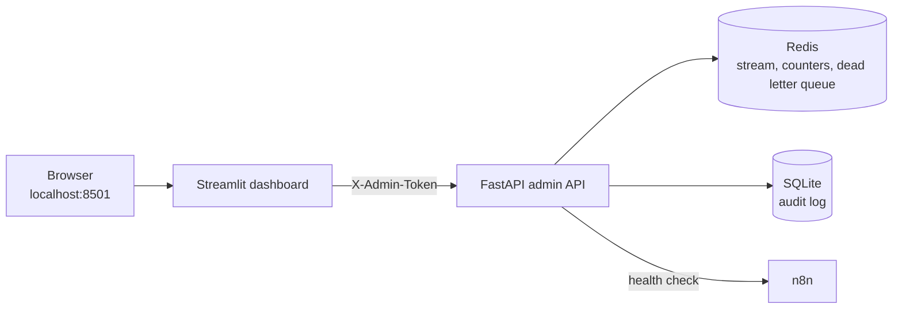

# Dashboard: how it works

The dashboard is a live, read-mostly view of Event Orchestrator, built with Streamlit. It shows what the system has received and processed, whether n8n is healthy, and which events failed, with one-click replay.

**Open it at http://localhost:8501** after `docker compose up -d`.

The page refreshes itself every 3 seconds, so you can leave it open while sending test events. There is no refresh button.

## What you see

### 1. Counters

| Tile | What it counts |
|---|---|
| **Received** | Events accepted into the queue, from webhooks and the optional queue input. Events rejected as duplicates at the door are not included. |
| **Processed** | Events that finished successfully. |
| **Retries** | Retry attempts so far. An event that fails five times adds four, because the first attempt is not a retry. |
| **Duplicates blocked** | Repeat deliveries that were stopped, both at the API and in the worker. These never run their workflow twice. |
| **Pending** | Events a worker has picked up but not finished yet, including events currently waiting between retries. |
| **Dead-lettered** | Events **currently** in the dead letter queue. This number goes down when you replay an event. |

### 2. n8n

| Item | Meaning |
|---|---|
| **Status** | **Healthy** when n8n answers its health check, **Down** when it cannot be reached. |
| Execution table | Appears when `N8N_API_KEY` is set in `.env`: n8n's recent runs with id, status, mode, and start and stop times. |
| "Set N8N_API_KEY..." note | Normal if you have not configured the optional key. Health still works without it. |

To enable execution history, create a key in n8n under **Settings > n8n API**, add it to `.env` as `N8N_API_KEY`, and run `docker compose up -d`.

### 3. Recent events

The latest 50 outcomes, newest first, from the SQLite audit log.

| Column | Meaning |
|---|---|
| `ts` | When the outcome was recorded, in **UTC** |
| `event_id` | The event's ID |
| `type` | Event type, such as `order.created` |
| `executor` | Which executor handled it: `n8n` (or `groq` for the experimental `ai.*` route) |
| `status` | `succeeded`, `dead_lettered`, or `duplicate` |
| `attempts` | How many tries it took |
| `error` | The last error for failed events |
| `result` | A short result message when one is available |

One event can appear more than once. For example, an event that is replayed and fails again shows two `dead_lettered` rows, one per run.

### 4. Dead letter queue

Every event that ran out of retries, or failed with an error that retrying cannot fix, is listed here. Each entry expands to show:

- the **attempt count**
- the **last error**
- the full **payload**
- a **Replay** button

The entry title reads `event_id (type) - reason`:

| Reason | Meaning |
|---|---|
| `retries_exhausted` | A transient error (for example n8n returned 500, or was unreachable) kept happening until the attempts ran out |
| `permanent_error` | A non-retryable error, such as n8n returning 404 because the workflow is not published |
| `unexpected_error` | Something unexpected went wrong while processing |
| `invalid_signature`, `invalid_payload` | A message from the optional queue input was rejected. These are shown for visibility and **cannot be replayed**, because replaying them would bypass verification. |

**Replay** puts the event back into the queue and removes it from the dead letter queue. The result shows up as a new row in Recent events. **Replay all** does this for every replayable entry.

Replaying only helps if the cause is fixed. An event whose payload asks n8n to fail (`--fail`) will fail again every time.

## Try it

With the virtual environment active:

| Command | What changes on the dashboard |
|---|---|
| `python -m scripts.send_test_event` | Received +1, Processed +1, a `succeeded` row |
| `python -m scripts.send_test_event --id evt_dup2 --repeat 3` | Received +1, Duplicates blocked +2 |
| `python -m scripts.send_test_event --fail` | Retries climb, then Dead-lettered +1 and a dead letter entry appears |
| `python -m scripts.send_test_event --bad-signature` | Nothing. The request is rejected before it reaches the queue. |
| `python -m scripts.demo_recovery` | n8n goes **Down**, an event dead-letters, n8n returns, replay turns it into `succeeded` |

## How it works

The dashboard never touches Redis or the database directly. It calls the admin API, which keeps one place responsible for reading and replaying.

| Endpoint | Used for |
|---|---|
| `GET /admin/stats` | Counters |
| `GET /admin/events` | Recent events |
| `GET /admin/dlq` | Dead letter queue |
| `GET /admin/n8n` | n8n status and execution history |
| `POST /admin/dlq/{entry_id}/replay` | Replay one event |
| `POST /admin/dlq/replay-all` | Replay everything replayable |

The admin API checks the `X-Admin-Token` header against `ADMIN_TOKEN`. The dashboard container reads the same `.env` file, so it sends the right token automatically. The code is in `dashboard/streamlit_app.py`.

## Troubleshooting

| What you see | What to do |
|---|---|
| "API unreachable" | Run `docker compose ps` and check that `api` is running. Test `http://localhost:8000/health`. |
| Page will not load | Check `docker compose ps` for `dashboard`, then `docker compose logs dashboard --tail 30`. |
| n8n shows **Down** while n8n is running | n8n may still be starting. Wait about 30 seconds, and check `N8N_BASE_URL` if it persists. |
| Counters stay at 0 after sending events | Check `docker compose logs worker --tail 30`. The worker may have crashed. |
| Events land in the dead letter queue straight away with a 404 | The n8n workflow is not published. Publish it, then replay. |
| Events dead-letter with `n8n returned 500` | Open n8n's **Executions** tab and read the error on the failed run. It is often the Slack step. |

## Limitations

- Timestamps are in UTC.
- Recent events shows the latest 50 rows. The audit log in `data/audit.db` keeps the full history.
- "Dead-lettered" counts what is in the queue now, not how many events have ever failed.
- The view is for monitoring and replay. It does not edit events or settings.
- The Redis stream is length-capped, so very old queue entries are trimmed. The audit log is unaffected.
