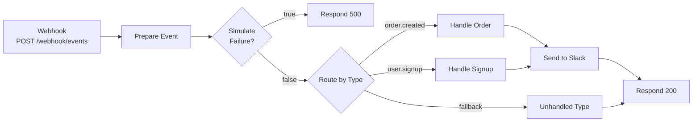
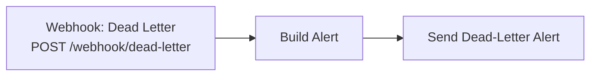

# n8n workflow: how it works

Event Orchestrator uses one n8n workflow, `event_router`, with two lanes. The Python worker sends events to it, and it turns them into Slack messages. The importable file is [`n8n/workflows/event_router.json`](../n8n/workflows/event_router.json).


| Lane | Production URL | Purpose |
|---|---|---|
| 1. Event router | `POST /webhook/events` | Route an event by type and post it to Slack |
| 2. Dead-letter alert | `POST /webhook/dead-letter` | Post a Slack alert when an event runs out of retries |

n8n handles the integrations and message formatting. The retries, idempotency, and dead letter queue live in the Python core, so n8n only has to answer clearly: success or failure.

## Lane 1: event router



### What the worker sends

```http
POST /webhook/events
Content-Type: application/json
X-Event-Id: evt_123

{ "id": "evt_123", "type": "order.created", "data": { "amount": 42 } }
```

The `X-Event-Id` header carries the event ID so workflows can deduplicate downstream.

### Node by node

| Node | n8n node type | What it does |
|---|---|---|
| **Webhook** | Webhook | Receives the POST. Response mode is "Using Respond to Webhook node", so the worker only gets an answer once the workflow decides one. |
| **Prepare Event** | Code | Reads the request body and outputs a flat object: `event_id`, `type`, `data`, and `fail` (true only when `data.simulate_failure` is exactly `true`). |
| **Simulate Failure?** | IF | Sends the event down the failure branch when `fail` is true. This exists so retries and the dead letter queue are easy to demonstrate. |
| **Respond 500** | Respond to Webhook | Returns HTTP 500 with `{"status":"error","event_id":...}`. The worker sees a transient error and retries. |
| **Route by Type** | Switch | Compares `type` against `order.created` and `user.signup`. Anything else goes out of the fallback output. |
| **Handle Order** | Code | Builds the Slack message for an order: a text line plus formatted blocks with the event ID and amount (or `n/a` if missing). |
| **Handle Signup** | Code | Builds the Slack message for a signup event. |
| **Unhandled Type** | Code | Passes unknown event types through without creating a Slack message. |
| **Send to Slack** | HTTP Request | POSTs the prepared message to your Slack incoming webhook. The URL comes from the `SLACK_WEBHOOK_URL` environment variable, with an 8 second timeout. |
| **Respond 200** | Respond to Webhook | Returns `{"status":"ok","event_id":...,"result":"<type> handled by n8n"}`. |

### The Slack message

Both handler nodes build a payload with a plain `text` fallback (used in notifications) and Slack Block Kit `blocks`:

```json
{
  "text": ":package: New order evt_123 (amount: 42)",
  "blocks": [
    { "type": "section", "text": { "type": "mrkdwn",
      "text": ":package: *New order*\nEvent `evt_123` | amount *42*" } },
    { "type": "context", "elements": [ { "type": "mrkdwn",
      "text": "order.created | processed by Event Orchestrator" } ] }
  ]
}
```

Event fields are escaped (`&`, `<`, `>` become HTML entities) before they go into a message. Without this, an event ID such as `<!channel>` would trigger a channel-wide notification.

## Lane 2: dead-letter alert




When an event is dead-lettered, the worker calls this webhook with:

```json
{
  "event_id": "evt_123",
  "type": "order.created",
  "reason": "retries_exhausted",
  "attempts": 5,
  "error": "n8n returned 500"
}
```

| Node | What it does |
|---|---|
| **Webhook: Dead Letter** | Receives the alert. It answers immediately ("Respond: Immediately"), because the worker does not need to wait for Slack. |
| **Build Alert** | Builds a Slack message with the event, the reason, the attempt count, the last error, and a pointer to the dashboard for replay. |
| **Send Dead-Letter Alert** | Posts it to the same Slack webhook. |

If n8n itself is down when an event is dead-lettered, this lane cannot run. The worker then posts a plain-text alert straight to Slack, so you still get notified.

## How n8n's answers drive the worker

The worker reads the HTTP status n8n returns:

| Situation | What n8n returns | What the worker does |
|---|---|---|
| Event handled and posted to Slack | 200 | Marks the event done |
| `data.simulate_failure` is `true` | 500 from the Respond 500 node | Retries with backoff, then dead-letters |
| A node fails (for example Slack is down or the webhook URL is wrong) | An error response, normally 500 | Retries with backoff, then dead-letters |
| Workflow not published | 404 | Treats it as permanent and dead-letters immediately |
| n8n not running | Connection refused | Retries with backoff, then dead-letters and alerts Slack directly |

Open n8n's **Executions** tab to see the runs behind each row.

## Setup

1. Create a Slack incoming webhook and put the URL in `.env` as `SLACK_WEBHOOK_URL` (see the main README).
2. In n8n, choose **Workflows > Import from file** and pick `n8n/workflows/event_router.json`.
3. Click **Publish**. The worker calls the production URLs, which only work once the workflow is published.

The Slack URL is not stored in the workflow file. `docker-compose.yml` passes it to the n8n container, and the HTTP Request nodes read it with the expression `{{ $env.SLACK_WEBHOOK_URL }}`. That requires `N8N_BLOCK_ENV_ACCESS_IN_NODE=false`, which the compose file already sets. Both settings are applied when the container is created, so after changing `.env` run `docker compose up -d`.

If n8n says the path `events` is already in use, another workflow with the same webhook path is published. Unpublish or archive it first.

## Test it by hand

n8n's **Execute workflow** button listens on a temporary test URL (`/webhook-test/events`) and is only for building. Published workflows use the production URL and do not need it.

To send an event straight to the workflow from PowerShell (this skips the signature check and idempotency, and it posts to Slack for real):

```powershell
Invoke-RestMethod -Method Post -Uri "http://localhost:5678/webhook/events" `
  -ContentType "application/json" `
  -Body '{"id":"evt_manual_1","type":"order.created","data":{"amount":42}}'
```

Expected response: `status: ok`, `event_id: evt_manual_1`, and a message in your Slack channel. For the full pipeline, use `python -m scripts.send_test_event`.

## Extend it

To add an event type, for example `payment.failed`:

1. In **Route by Type**, add a rule where `type` equals `payment.failed`.
2. Add a Code node that returns `{ ...e, slack_payload: { text, blocks } }`, copying **Handle Order** as a starting point.
3. Connect the new rule to the new node, and the new node to **Send to Slack**.
4. Click **Publish**.

No Python changes are needed. To add a different action instead of Slack (Google Sheets, email, and so on), place the node between a handler and **Respond 200**. If it fails, n8n answers with an error and the worker retries the whole workflow.

## Limitations

- **At-least-once delivery.** If the worker crashes after Slack has been posted but before the event is marked done, the event runs again and Slack receives a second message. The event ID in each message makes duplicates recognisable.
- **Unknown event types are acknowledged, not announced.** They get a 200 response but no Slack message. The response text still says "handled by n8n".
- **One channel.** A Slack incoming webhook posts to the single channel chosen when it was created, and cannot read replies. Interactive actions would need a Slack bot token.
- **Environment access in n8n is enabled** (`N8N_BLOCK_ENV_ACCESS_IN_NODE=false`) so the Slack URL can stay out of the workflow file. That is fine locally; review it before exposing n8n publicly.
